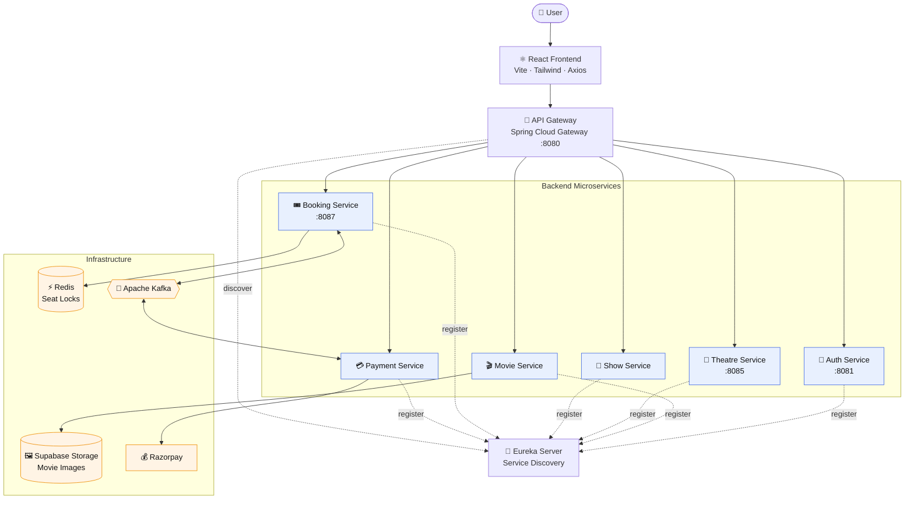
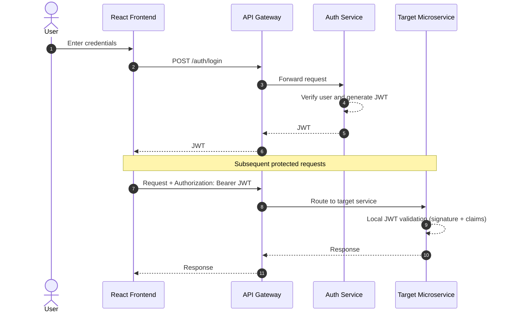
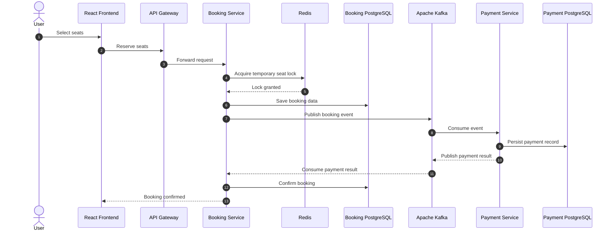
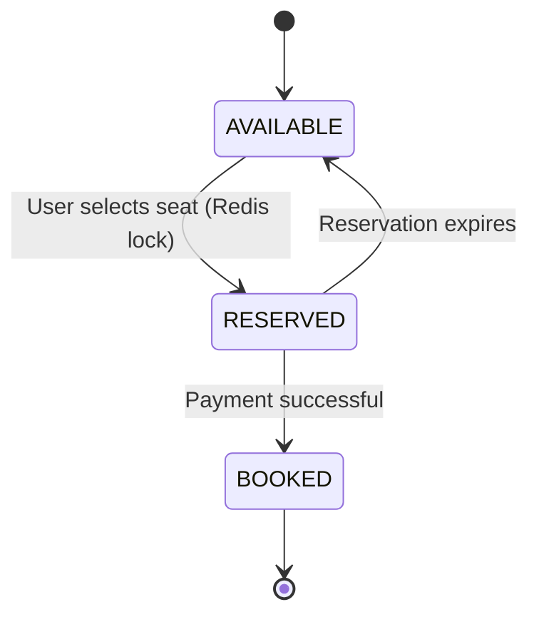
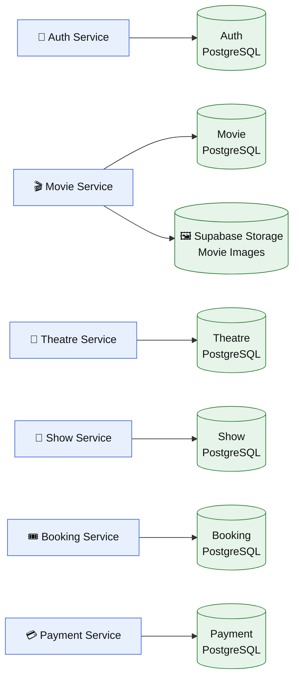
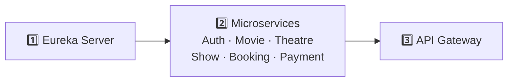

<div align="center">

# 🎬 CineHub

### A BookMyShow-inspired movie ticket booking platform
**Spring Boot Microservices · React · Redis · Kafka · PostgreSQL**


· [🏗️ Architecture](#️-architecture) · [✨ Features](#-key-features) · [🚀 Getting Started](#-getting-started) · [🧪 Testing](#-testing)

</div>

---

## 📖 Overview

**CineHub** is a full-stack movie ticket booking platform built on a **distributed microservices architecture**. It covers the complete booking journey: authentication, movie management, theatre operations, show scheduling, seat selection, booking, and payment.

| Design Principle | How CineHub Applies It |
|---|---|
| 🚪 **Single entry point** | All frontend traffic flows through a Spring Cloud API Gateway |
| 🔐 **Stateless security** | JWT issued once at login, validated locally by each service |
| 🗄️ **Data isolation** | Database-per-service with PostgreSQL |
| 💺 **Concurrency safety** | Redis temporary seat locks prevent double booking |
| 📨 **Loose coupling** | Kafka connects Booking and Payment asynchronously |
| 🔎 **Dynamic discovery** | Eureka handles service registration and lookup |

---


## 🏗️ Architecture

The React frontend communicates with backend services exclusively through the API Gateway. Services register with Eureka and own their data stores.



---

## 🔐 Authentication Flow

The **Auth Service** handles login and issues the JWT. It is **not** called for every protected request. Each protected service independently validates the token's signature and claims.



---

## 💺 Booking & Payment Flow

Booking and Payment are decoupled through Kafka. Redis guarantees that only one user can hold a seat at a time.



---

## 🔄 Seat Lifecycle

A seat moves through well-defined states. Unpaid reservations expire automatically, returning the seat to the pool.



---

## 🗄️ Database Architecture

CineHub follows the **database-per-service** pattern. Services never share tables, which keeps boundaries clean and lets each service evolve independently.



> Movie data lives in PostgreSQL, while movie image files are stored separately in Supabase Storage.

---

## ✨ Key Features

| | Feature | Description |
|---|---|---|
| 🔐 | **Authentication & Authorization** | JWT authentication, OTP verification, and role-based access |
| 🎬 | **Movie Management** | Browse movies and manage the movie catalogue |
| 🖼️ | **Movie Image Storage** | Movie images stored using Supabase Storage |
| 🏢 | **Theatre Management** | Theatre-owner requests, theatres, screens, and seats |
| 📅 | **Show Management** | Show creation, scheduling, and status management |
| 💺 | **Seat Reservation** | Redis-based temporary seat locking for concurrent reservations |
| 🎟️ | **Booking Management** | Seat reservation, booking confirmation, and booking history |
| 💳 | **Payment Processing** | Razorpay payment integration and verification |
| 📨 | **Event Communication** | Kafka messaging between Booking and Payment services |
| 🔎 | **Service Discovery** | Eureka-based registration and discovery |
| 🚪 | **API Gateway** | Centralized routing for all frontend API requests |

---

## 🧩 Microservices

| Service | Responsibility |
|---|---|
| 🔎 **Eureka Server** | Service registration and discovery |
| 🚪 **API Gateway** | Request routing and centralized entry point |
| 🔐 **Auth Service** | Login, registration, OTP, and JWT issuance |
| 🎬 **Movie Service** | Movie catalogue and movie management |
| 🏢 **Theatre Service** | Theatres, screens, and seats |
| 📅 **Show Service** | Shows and scheduling |
| 🎟️ **Booking Service** | Seat reservation and booking management |
| 💳 **Payment Service** | Payment processing |
| 📦 **Common Lib** | Shared models and utilities |
| ⚛️ **React Frontend** | User-facing application |

---

## 🛠️ Technology Stack

| Category | Technologies |
|---|---|
| **Backend** | Java 21, Spring Boot |
| **Microservices** | Spring Cloud, Eureka |
| **API Gateway** | Spring Cloud Gateway |
| **Security** | Spring Security, JWT |
| **Database** | PostgreSQL |
| **Data Access** | Spring Data JPA, Hibernate |
| **Caching / Locking** | Redis |
| **Messaging** | Apache Kafka |
| **Storage** | Supabase Storage |
| **Payments** | Razorpay |
| **Frontend** | React, Vite, Tailwind CSS |
| **HTTP Client** | Axios |
| **Build Tool** | Maven |
| **Containerization** | Docker, Docker Compose |
| **Testing** | Postman, k6 |
| **Deployment** | Render, Netlify |

---

## 🔌 Main Ports

| Component | Port |
|---|---|
| API Gateway | `8080` |
| Auth Service | `8081` |
| Theatre Service | `8085` |
| Booking Service | `8087` |
| Eureka Server | Configured in project |
| React Frontend | Vite development port |

> Other services use the ports defined in their respective `application` configuration files.

---

## 📁 Project Structure

```text
cinehub-microservices/
│
├── api-gateway/        # Spring Cloud Gateway
├── auth-service/       # Login, OTP, JWT issuance
├── booking-service/    # Seat reservation & bookings
├── common-lib/         # Shared models and utilities
├── eureka-server/      # Service discovery
├── movie-service/      # Movie catalogue
├── payment-service/    # Payment processing
├── show-service/       # Show scheduling
├── theatre-service/    # Theatres, screens, seats
│
├── cinehubReact/       # React frontend
│   ├── src/
│   ├── public/
│   ├── package.json
│   └── package-lock.json
│
├── postgres/
├── docker-compose.yml
├── pom.xml
└── README.md
```

---

## 🚀 Getting Started

### Prerequisites

- ☕ JDK 21
- 📦 Maven
- 🟢 Node.js
- 🐳 Docker Desktop
- 🔧 Git

### 1. Clone the repository

```bash
git clone https://github.com/prajangowda/cinehub-microservices.git
cd cinehub-microservices
```

### 2. Start infrastructure

```bash
docker compose up -d
```

### 3. Start the backend

Start the services in this order:



### 4. Start the frontend

```bash
cd cinehubReact
npm install
npm run dev
```

Configure the frontend API URL:

```env
VITE_API_BASE_URL=http://localhost:8080/api/v1
```

> ⚠️ **Never commit `.env` files containing secrets.**

---

## 🧪 Testing

| Tool | Purpose |
|---|---|
| **Postman** | REST API testing |
| **k6** | Load and concurrency testing |
| **ngrok** | Exposing local endpoints when required |

---

## 🎯 Architecture Highlights

- ✅ Microservices instead of a single monolithic backend
- ✅ API Gateway as the frontend entry point
- ✅ JWT issued at authentication and validated locally by services
- ✅ Database-per-service for data isolation
- ✅ Redis for concurrent seat locking
- ✅ Kafka for asynchronous Booking → Payment communication
- ✅ Supabase Storage for movie images
- ✅ Eureka for service discovery
- ✅ Docker for infrastructure and local development

---

## 👨‍💻 Author

**Prajan Gowda**
Java Backend Development · Spring Boot · Microservices · REST APIs · PostgreSQL · Redis · Kafka

[](https://github.com/prajangowda)

<div align="center">

⭐ If you found this project useful, consider giving it a star!

</div>
