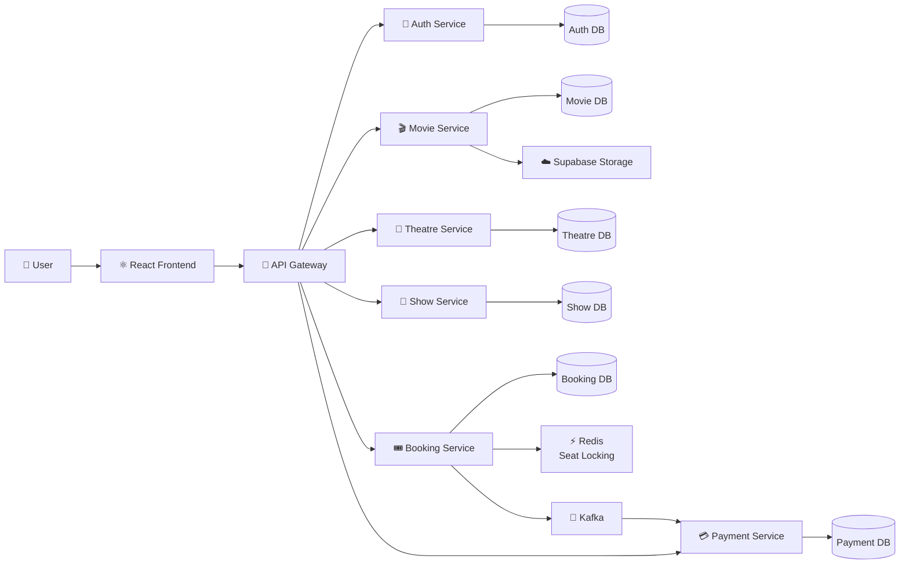

🎬 CineHub — Movie Ticket Booking Platform
A full-stack movie ticket booking platform built with Spring Boot Microservices and React.

🚀 Overview
CineHub is a BookMyShow-inspired movie ticket booking platform built using a distributed microservices architecture.
The platform provides functionality for authentication, movie management, theatre operations, show scheduling, seat selection, booking, and payment processing.
The system is designed around independent services with API Gateway routing, JWT-based authentication, database-per-service, Redis seat locking, and Kafka-based communication between Booking and Payment services.
🌐 Live Demo
- Frontend: Explore CineHub
🏗️ Architecture
CineHub follows a microservices architecture where the React frontend communicates with backend services through an API Gateway.

🔐 Authentication Flow
The Auth Service handles login and issues the JWT. It is not called for every protected request.
User
  │
  ▼
React Frontend
  │
  │ Login
  ▼
API Gateway
  │
  ▼
Auth Service
  │
  └──► Generate JWT
          │
          ▼
    React Frontend
          │
          │ JWT
          ▼
     API Gateway
          │
          ▼
   Target Microservice
          │
          ▼
   Local JWT Validation
Each protected service independently validates the JWT's signature and claims.
💺 Booking & Payment Flow
React Frontend
      │
      ▼
API Gateway
      │
      ▼
Booking Service
      │
      ├──► Redis
      │    Temporary seat lock
      │
      ├──► PostgreSQL
      │    Booking data
      │
      └──► Kafka
             │
             ▼
       Payment Service
             │
             └──► PostgreSQL
✨ Key Features
- 🔐 Authentication & Authorization — JWT authentication, OTP verification, and role-based access.
- 🎬 Movie Management — Browse movies and manage the movie catalogue.
- 🖼️ Movie Image Storage — Movie images stored using Supabase Storage.
- 🏢 Theatre Management — Theatre-owner requests, theatres, screens, and seats.
- 📅 Show Management — Show creation, scheduling, and show status management.
- 💺 Seat Reservation — Redis-based temporary seat locking to handle concurrent reservations.
- 🎟️ Booking Management — Seat reservation, booking confirmation, and booking history.
- 💳 Payment Processing — Payment integration and verification.
- 📨 Event Communication — Kafka communication between Booking and Payment services.
- 🔎 Service Discovery — Eureka-based service registration and discovery.
- 🚪 API Gateway — Centralized routing for frontend API requests.
🛠️ Technology Stack
Category	Technologies
Backend	Java 21, Spring Boot
Microservices	Spring Cloud, Eureka
API Gateway	Spring Cloud Gateway
Security	Spring Security, JWT
Database	PostgreSQL
Data Access	Spring Data JPA, Hibernate
Caching / Locking	Redis
Messaging	Apache Kafka
Storage	Supabase Storage
Payments	Razorpay
Frontend	React, Vite, Tailwind CSS
HTTP Client	Axios
Build	Maven
Containerization	Docker, Docker Compose
Testing	Postman, k6
Deployment	Render, Netlify

🧩 Microservices
Service	Responsibility
Eureka Server	Service registration and discovery
API Gateway	Request routing and centralized entry point
Auth Service	Login, registration, OTP and JWT issuance
Movie Service	Movie catalogue and movie management
Theatre Service	Theatres, screens and seats
Show Service	Shows and scheduling
Booking Service	Seat reservation and booking management
Payment Service	Payment processing
Common Lib	Shared models and utilities
React Frontend	User-facing application

🗄️ Database Architecture
CineHub follows the database-per-service pattern.
Each business service has its own PostgreSQL database:
Auth Service       → Auth PostgreSQL
Movie Service      → Movie PostgreSQL
Theatre Service    → Theatre PostgreSQL
Show Service       → Show PostgreSQL
Booking Service    → Booking PostgreSQL
Payment Service    → Payment PostgreSQL
Services do not directly share database tables.
Movie image files are stored separately:
Movie Service
     ├── Movie data   → PostgreSQL
     └── Movie images → Supabase Storage
💺 Seat Locking
Redis is used by the Booking Service for temporary seat locking.
AVAILABLE
    │
    ▼
RESERVED
    │
    ├── Payment successful ──► BOOKED
    │
    └── Reservation expires ─► AVAILABLE
This helps prevent multiple users from reserving the same seat concurrently.
📨 Kafka Communication
Booking and Payment communicate asynchronously through Kafka.
Booking Service
      │
      │ Publish Event
      ▼
 Apache Kafka
      │
      │ Consume Event
      ▼
Payment Service
This reduces direct coupling between the Booking and Payment services.
🔌 Main Ports
Component	Port
API Gateway	8080
Auth Service	8081
Theatre Service	8085
Booking Service	8087
Eureka Server	Configured in project
React Frontend	Vite development port

Other services use the ports configured in their respective application configuration files.
📁 Project Structure
cinehub-microservices/
│
├── api-gateway/
├── auth-service/
├── booking-service/
├── common-lib/
├── eureka-server/
├── movie-service/
├── payment-service/
├── show-service/
├── theatre-service/
│
├── cinehubReact/
│   ├── src/
│   ├── public/
│   ├── package.json
│   └── package-lock.json
│
├── postgres/
├── docker-compose.yml
├── pom.xml
└── README.md
🐳 Running Locally
Prerequisites
- JDK 21
- Maven
- Node.js
- Docker Desktop
- Git
Clone
git clone https://github.com/prajangowda/cinehub-microservices.git
cd cinehub-microservices
Start Infrastructure
docker compose up -d
Start the Eureka Server, microservices, and API Gateway.
Start Frontend
cd cinehubReact
npm install
npm run dev
Configure the frontend API URL:
VITE_API_BASE_URL=http://localhost:8080/api/v1
Do not commit .env files containing secrets.
🧪 Testing
The project uses:
- Postman — REST API testing
- k6 — Load and concurrency testing
- ngrok — Local endpoint exposure when required
🎯 Architecture Highlights
- Microservices instead of a single monolithic backend
- API Gateway as the frontend entry point
- JWT issued during authentication and validated locally by services
- Database-per-service for data isolation
- Redis for concurrent seat locking
- Kafka for asynchronous Booking → Payment communication
- Supabase Storage for movie images
- Eureka for service discovery
- Docker for infrastructure and local development
👨‍💻 Author
Prajan Gowda
Java Backend Development • Spring Boot • Microservices • REST APIs • PostgreSQL • Redis • Kafka
